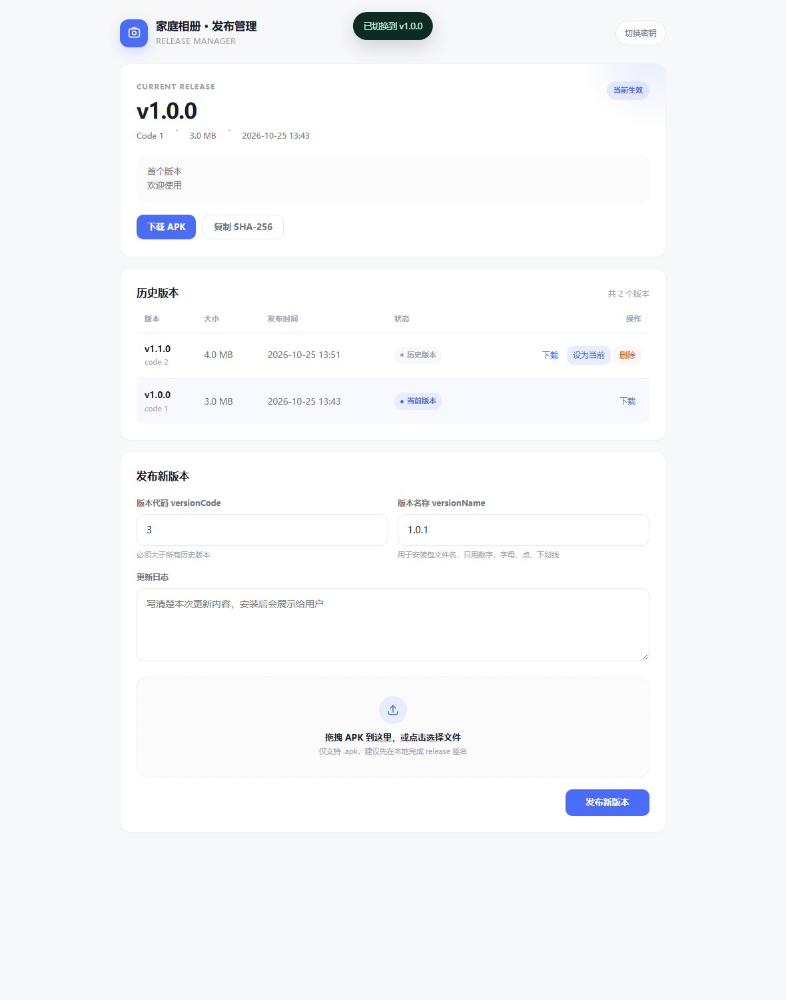

# album-server

局域网家庭相册后端。Spring Boot 3.3 + Java 21 + SQLite，Docker 一键部署。
面向家庭 / 小团队，无公网依赖，所有照片保存在自己的机器上。

## 功能

- 用户注册 / 登录 / 登出，随机 token 会话（30 天），BCrypt 密码哈希
- 朋友圈动态：文字 + 图片 / 视频，游标分页，只能删除自己的动态
- 朋友圈相册：所有有效动态媒体按拍摄时间聚合的只读时间轴
- 普通相册：新建 / 重命名 / 删除、多文件上传、移除媒体、设置封面
- 图片 EXIF 拍摄时间、ffprobe 视频时长、ffmpeg 首帧缩略图
- 软删除动态；独立媒体孤儿文件自动清理
- `/files/**` 静态文件服务，HikariCP pool=1 + SQLite WAL
- App 强制更新：版本检查、APK 下载、Range、SHA-256、历史版本与软回滚
- `/admin` 可视化发布后台：上传、进度、回滚、删除

## 快速开始

要求：Docker 24+、Docker Compose v2。

```bash
cd album-server

# Linux 宿主机：bind mount 的 data 目录必须让容器内 uid=1000 可写
sudo mkdir -p data/media/thumbs backups
sudo chown -R 1000:1000 data

# 可选：复制环境变量示例
cp .env.example .env

docker compose up -d --build
curl http://127.0.0.1:8000/health
# {"ok":true,"db":"ok"}

docker compose ps
```

首次构建需要下载 Maven 依赖和 ffmpeg，视网络情况约 2~5 分钟。
容器 `start_period` 为 30s，JVM 冷启动通常 5~10s，看到 `healthy` 即可使用。

手机和服务器连同一个 Wi-Fi，在 App 中填写 `http://<服务器局域网IP>:8000`。
Linux 上可用 `hostname -I` 或 `ip addr` 查看 IP；记得放行防火墙 8000 端口：

```bash
sudo ufw allow 8000/tcp
```

## 部署到另一台 Docker 主机（推荐）

本地不需要安装 Docker，直接在服务器上构建镜像即可。
从开发机把源码同步到服务器（**排除本机测试产生的 data、backups、target**）：

```bash
# 在开发机执行
rsync -avz --delete \
  --exclude 'target' \
  --exclude 'data' \
  --exclude 'backups' \
  --exclude '.git' \
  ./album-server/ <user>@<server>:/home/<user>/album-server/
```

登录服务器完成首次部署：

```bash
ssh <user>@<server>
cd ~/album-server

mkdir -p data/media/thumbs backups
sudo chown -R 1000:1000 data
cp .env.example .env
# 按需修改 TZ、MAX_UPLOAD_SIZE、JAVA_OPTS

docker compose up -d --build
docker compose ps
curl -s http://127.0.0.1:8000/health
```

如果当前用户没有 Docker 权限：

```bash
sudo usermod -aG docker "$USER"
# 重新登录 SSH 后生效，再执行 docker compose
```

服务器防火墙 / 云安全组放行 8000。手机与服务器同 Wi-Fi 时，App 服务器地址填：

```text
http://<服务器局域网IP>:8000
```

更新版本只需再次 rsync（排除 data），然后执行：

```bash
cd ~/album-server && docker compose up -d --build
```

> 如果服务器在公网，强烈建议不要直接暴露 HTTP 8000：用 Tailscale / WireGuard
> 组建虚拟局域网，或在 Caddy / Nginx 后面加 HTTPS 再填 `https://` 地址。
>
> 国内服务器首次构建如果拉取 Docker Hub 较慢，给 Docker 配置镜像加速。
> Alpine 官方 CDN 不通时，Dockerfile 已默认把 apk 源替换为阿里云；
> 如仍失败，在 `.env` 中改 `APK_MIRROR=mirrors.cloud.tencent.com` 或
> `APK_MIRROR=mirrors.tuna.tsinghua.edu.cn` 后重新构建。
>
> Shell 里的 `HTTP_PROXY` / `HTTPS_PROXY` 不会自动进入 Docker 构建；
> 若服务器必须走代理，请配置 Docker daemon/buildkit 的代理，或构建时传
> `--build-arg HTTP_PROXY=... --build-arg HTTPS_PROXY=...`。

## 数据目录

```
album-server/
├── data/
│   ├── app.db            # SQLite（WAL 模式，会生成 app.db-wal / app.db-shm）
│   ├── media/
│   │   ├── <uuid>.jpg    # 原图 / 原视频
│   │   └── thumbs/
│   │       └── <uuid>_t.jpg
│   └── releases/
│       ├── metadata.json
│       └── app-vX.Y.Z.apk
└── backups/
```

`docker-compose.yml` 把宿主机 `./data` 挂载到容器 `/data`。
**不要在容器运行中直接复制 SQLite 文件**，先停服或用在线备份方式。

### 启动时报 `/data/media` AccessDeniedException

容器内进程固定以 **UID 1000** 运行；bind mount 的宿主机 `data/` 如果由 root
或其他 UID 创建，容器就无法创建 `/data/media`。在**宿主机**执行：

```bash
cd ~/album-server
docker compose down
sudo mkdir -p data/media/thumbs
sudo chown -R 1000:1000 data
sudo chmod 755 data
docker compose up -d
```

确认挂载和用户：

```bash
stat -c '%u:%g %a %n' data
docker compose exec album id
# uid=1000(app) gid=1000(app)
```

如果 `chown` 后仍然失败：

- 检查目录所在文件系统是否只读、NFS root-squash、SMB 挂载不支持 Linux 权限；
- CentOS / RHEL / Fedora 开启 SELinux 时，把卷改成 `./data:/data:Z` 或执行
  `sudo chcon -Rt container_file_t data`；
- rootless Docker 的 UID 映射不同，需要把宿主机实际映射到的 UID 给 `data`。
- `docker inspect album-server --format '{{json .Mounts}}'` 确认 `RW` 为 `true`。

## 环境变量

| 变量 | 默认值 | 说明 |
|---|---|---|
| `TZ` | `Asia/Shanghai` | 容器时区；影响日期分组与拍摄时间 |
| `APK_MIRROR` | `mirrors.aliyun.com` | 构建时 Alpine apk 镜像源；海外服务器可置空 |
| `DATA_DIR` | `/data` | 数据库与媒体根目录（容器内） |
| `MAX_UPLOAD_SIZE` | `524288000` | 单文件上限，字节（默认 500MB） |
| `TOKEN_DAYS` | `30` | 登录 token 有效期 |
| `ALLOWED_ORIGINS` | `*` | CORS 白名单，逗号分隔 |
| `UPLOAD_SECRET` | `change-me-in-production` | `/admin` 与发布/回滚/删除接口密钥，生产必改 |
| `JAVA_OPTS` | `-Xms256m -Xmx512m -XX:+UseZGC` | JVM 参数 |

Spring Boot multipart 上限在 `application.yml`（500MB 单文件 / 600MB 请求），
`MAX_UPLOAD_SIZE` 是业务层兜底，两者同时生效。

## JVM 内存调整

小内存机器（例如 1GB RAM 的盒子）建议：

```yaml
# docker-compose.yml
environment:
  JAVA_OPTS: "-Xms128m -Xmx384m -XX:+UseZGC"
deploy:
  resources:
    limits:
      memory: 768M
```

`-Xmx` 必须小于容器 memory limit，并给操作系统、ffmpeg 留至少 200MB。
大相册 / 高并发上传时可以升到 `-Xmx1g`，同时把容器内存调到 1.5G。
出现 `OOMKilled`（`docker inspect` 可见）时优先降低 `-Xmx` 或调大内存限制。

## 备份与恢复

### 停服冷备（最稳）

```bash
./scripts/backup.sh
# 备份完成：./backups/*_YYYYmmdd_HHMMSS.*
```

脚本流程：停止容器 → 复制 `data/app.db` → 启动容器 → 打包 `data/media` 和
`data/releases`（如果有）→ 删除 7 天前备份。

### 在线热备（可选）

镜像已安装 sqlite CLI：

```bash
docker compose exec album sqlite3 /data/app.db ".backup '/data/backup.db'"
docker cp album-server:/data/backup.db ./backups/app_$(date +%Y%m%d_%H%M%S).db
docker compose exec album rm /data/backup.db
```

恢复：停服 → 覆盖 `data/app.db` → 解压媒体和 releases → 启动。
注意 releases 里的 APK 与签名 keystore 必须一起长期保留，否则历史版本无法用于升级/回滚。

### 一键部署

```bash
./scripts/deploy.sh
```

## 开发（不使用 Docker）

要求 Java 21、Maven 3.9+、ffmpeg/ffprobe 已安装并在 PATH 中。

```bash
export DATA_DIR=$PWD/data
mvn spring-boot:run
```

测试：

```bash
mvn test
```

打包：

```bash
mvn clean package -DskipTests
java -jar target/album-server.jar
```

> 本地没有 ffmpeg 时，图片上传仍可用；视频上传会返回「ffprobe 处理失败」。
> Docker 镜像已通过 `apk add ffmpeg` 同时安装 ffmpeg 与 ffprobe。

## App 更新发布与 /admin

### 上传密钥

`UPLOAD_SECRET` 用于保护管理接口：

```bash
openssl rand -base64 32
# 把输出写入 .env
UPLOAD_SECRET=生成的随机串
```

然后：

```bash
docker compose up -d
```

浏览器打开：

```text
http://<服务器IP>:8000/admin
```



首次输入 `UPLOAD_SECRET`，验证通过后保存在浏览器 `localStorage`，关闭页面再打开可免密进入。
管理接口使用 Header `X-Upload-Secret`，不依赖用户登录 token。

### 发布版本

Web 后台可以：

- 查看当前生效版本、文件大小、发布时间、更新日志
- 拖拽/选择 APK 上传，实时显示上传百分比与速度
- 查看全部历史版本，当前版本高亮
- 回滚（把当前生效版本指针切到旧版本）
- 删除历史版本（当前版本禁止删除）

也可以命令行发布：

```bash
curl -X POST http://<服务器IP>:8000/api/app/release \
  -H "X-Upload-Secret: $UPLOAD_SECRET" \
  -F "file=@app-v1.1.0.apk" \
  -F "versionCode=2" \
  -F "versionName=1.1.0" \
  -F "notes=修复问题，优化相册加载"
```

约束：

- `versionCode` 必须大于所有历史版本
- 上传后新版本自动成为当前版本
- 同名 `app-v{versionName}.apk` 已存在时拒绝
- 旧版单对象 `metadata.json` 会在第一次读取时自动迁移为新格式
- 回滚是**软回滚**：只改变下发给 App 的当前版本，不会让已经安装高版本的用户降级
- 删除 APK 后历史记录同步移除；删除文件失败会留下不影响功能的孤儿文件

### 备份

`scripts/backup.sh` 现在会额外生成：

```text
backups/releases_YYYYmmdd_HHMMSS.tar.gz
```

里面是 `metadata.json` + 所有历史 APK。恢复时解压回 `data/releases` 即可。
注意：App 更新依赖**签名一致的 APK**，旧版本 APK 不能丢失。

## API 概览

所有 `/api/**`（除注册、登录）都需要：

```
Authorization: Bearer <token>
```

错误统一为 `{"detail":"错误信息"}` + 对应 HTTP 状态码。

| 方法 | 路径 | 说明 |
|---|---|---|
| GET | `/health` | 健康检查，无鉴权 |
| POST | `/api/auth/register` | 注册并签发 token |
| POST | `/api/auth/login` | 登录 |
| POST | `/api/auth/logout` | 删除当前会话 |
| GET | `/api/auth/me` | 当前用户 |
| GET | `/api/posts?cursor=&limit=20` | 朋友圈，posted_at DESC |
| POST | `/api/posts` | multipart：`content`, `files[]` |
| GET | `/api/posts/{id}` | 动态详情 |
| DELETE | `/api/posts/{id}` | 仅作者可删，软删除 |
| GET | `/api/gallery/feed?cursor=&limit=60` | 朋友圈相册，只读 |
| GET | `/api/albums` | 相册列表 |
| POST | `/api/albums` | 新建 `{title}` |
| PATCH | `/api/albums/{id}` | `{title?, cover_media_id?}` |
| DELETE | `/api/albums/{id}` | 删除相册并清理孤儿媒体 |
| GET | `/api/albums/{id}` | `{album, items}` |
| POST | `/api/albums/{id}/media` | multipart：`files[]` |
| DELETE | `/api/albums/{id}/media/{mid}` | 解除关联 / 清理独立媒体 |
| GET | `/api/app/latest` | 当前生效 App 版本，公开 |
| GET | `/api/app/download/{filename}` | APK 下载，公开，支持 Range |
| POST | `/api/app/release` | 上传新版本，需 `X-Upload-Secret` |
| GET | `/api/app/history` | 全部版本，需 `X-Upload-Secret` |
| POST | `/api/app/rollback/{versionCode}` | 软回滚当前版本指针 |
| DELETE | `/api/app/{versionCode}` | 删除历史版本，不能删当前版本 |

游标格式为 `<ISO时间>_<id>`，例如 `2026-10-24T22:01:10_42`，用
`(时间, id)` 元组比较翻页，不使用 OFFSET。

## 数据库迁移（Flyway 式 V 编号）

`src/main/resources/db/migration/` 下的 `V*.sql` 会在启动时按文件名字典序执行。
`MigrationRunner` 用 `_migrations` 表记录已执行文件。

- 命名：`V001__init.sql`、`V002__indexes.sql`（**两个下划线**）
- 只在末尾追加新文件；**一旦发布，不要修改已有迁移**
- 只用 `CREATE TABLE IF NOT EXISTS` / `CREATE INDEX IF NOT EXISTS` / `ALTER TABLE ADD COLUMN`
- 禁止 `DROP TABLE`
- 每个迁移文件 + `_migrations` 插入在同一个事务内

新增字段示例：

```sql
-- V003__album_description.sql
ALTER TABLE albums ADD COLUMN description TEXT;
```

## 目录结构

```
src/main/java/com/example/album/
├── config/        # 配置、数据源、静态资源、拦截器注册、迁移
├── controller/    # HTTP 层（含 /api/app 更新接口）
├── service/       # 业务逻辑（含 AppUpdateService 发布包清单）
├── repository/    # JdbcTemplate SQL
├── model/         # 数据库模型 + AppRelease / ReleaseManifest
├── dto/           # API 响应 / 请求 record
├── security/      # token 拦截器 + @Auth 参数解析
├── exception/     # 统一异常处理
└── util/          # 时间、游标工具
```

## 设计要点 / 已知限制

- SQLite 单写：连接池固定为 1，配合 WAL；吞吐适合家庭规模，不适合公开高并发。
- 仅 HTTP，请只在可信局域网内使用；如需公网请自行加 HTTPS 反向代理。
- 没有管理员角色，所有登录用户都可以管理普通相册；朋友圈动态严格校验作者。
- 删除动态是软删除，媒体文件会保留（用于恢复审计）；朋友圈相册通过 JOIN 隐藏。
- 图片支持 JPG/PNG/WebP/GIF/BMP；HEIC 请在手机端导出为 JPG 后上传。
- 视频处理依赖 ffmpeg/ffprobe，超时 60 秒并强制结束子进程。

## License

仅供家庭 / 内部使用。
